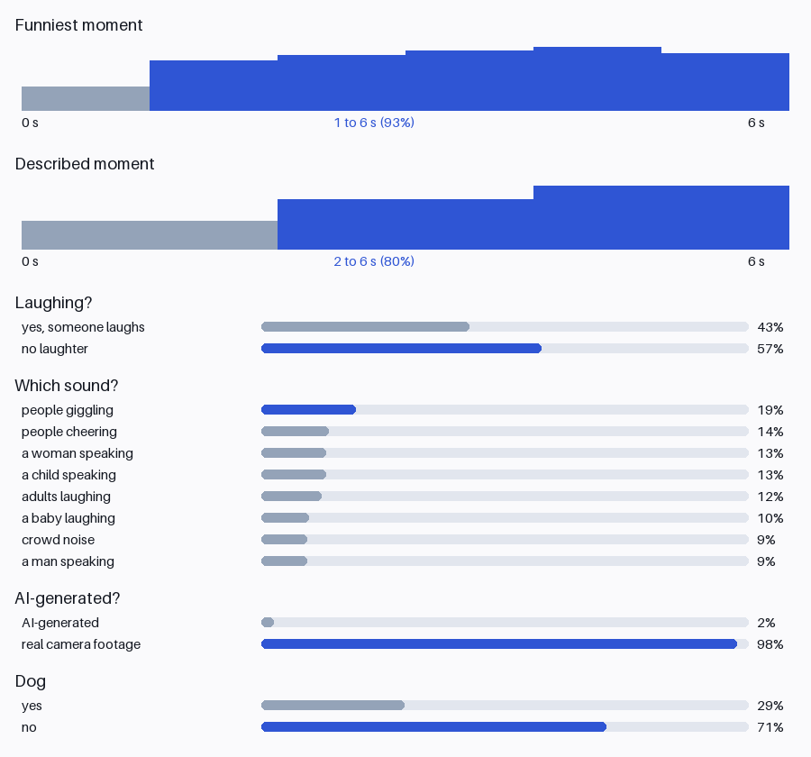
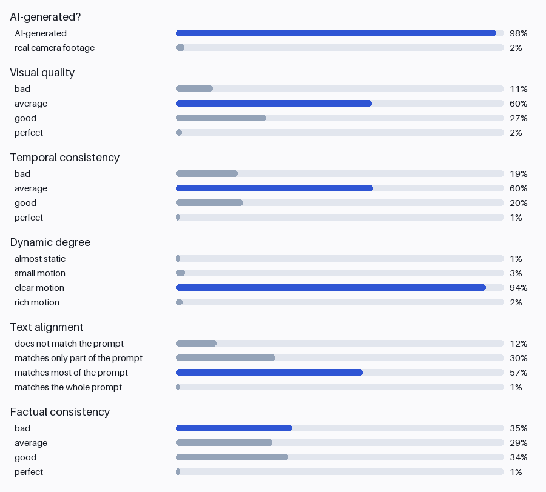

# ComfyUI-VideoJev

Ask a video typed questions in ComfyUI and get a probability for every possible answer.
One model reads the frames and the sound together.

Built by [Retina](https://retina.dev/coeus).
Model: [sp1d5r/video-jev](https://huggingface.co/sp1d5r/video-jev).
Code and paper: [github.com/sp1d5r/vjev](https://github.com/sp1d5r/vjev).



## What you can do with it

- **Filter or rank generations.** Video Jev Judge gives P(AI-generated) and five quality scores (visual quality, temporal consistency, motion, prompt match, physics) as numbers. Keep the best of N.
- **Cut highlights.** Video Jev Find Moment returns the start and end of "the funniest moment" or "a man opens the fridge", plus those frames, ready for Create Video.
- **Ask your own questions.** Video Jev Ask takes a Jev record: yes/no, multiple choice, ordered score, or "when?".

## Nodes

| Node | Inputs | Outputs |
|---|---|---|
| Video Jev Loader | weights (HF repo or folder), precision | model |
| Video Jev Ask | model, video, preset toggles, described moment, custom record | answers (JSON), chart |
| Video Jev Judge | model, video, generation prompt | p_ai_generated, quality_mean, 5 scores (1 to 4), JSON, chart |
| Video Jev Find Moment | model, video, question, mode | start_s, end_s, confidence, clip frames, JSON, chart |

Every node takes a `VIDEO` (from Load Video), or `IMAGE` frames plus their `fps`, and optional `AUDIO`.
Frames are resampled to the frame rate, length and size each question was trained on.



## Install

With ComfyUI-Manager: Install via Git URL, `https://github.com/sp1d5r/ComfyUI-VideoJev`.

By hand:

```bash
cd ComfyUI/custom_nodes
git clone https://github.com/sp1d5r/ComfyUI-VideoJev
pip install -r ComfyUI-VideoJev/requirements.txt
```

The first run downloads Qwen3-Omni-30B-A3B (about 66 GB) and the Video Jev adapter (714 MB) from Hugging Face.
Load `example_workflows/video_jev_all_nodes.json` to try every node.

## Hardware

| Precision | GPU memory | Speed (per question group) | Answers |
|---|---|---|---|
| `bf16` | about 62 GB (A100 80 GB, H100, RTX Pro 6000) | 0.6 s on an H200 | as in the paper |
| `offload` | `max_gpu_gib` (default 20, for 24 GB cards) + about 80 GB system RAM | 13 s on an H200 host with a 20 GiB cap; slower over consumer PCIe | same as bf16 (per-clip correlation 0.97) |

NVIDIA GPUs only.
4-bit loading is not offered: it saved only 3 GB on this model in our test.

## How good is it

On official test splits (full numbers in the paper):

| Task | Metric | Video Jev | Reference |
|---|---|---|---|
| AI-video quality (VideoFeedback) | mean Spearman | 0.743 | VideoScore 0.771 |
| Real or AI (VideoFeedback) | AUC | 0.996 | - |
| Text-query moments (QVHighlights) | R1@0.5 | 0.679 | Moment-DETR 0.539 |
| Funny or magic moment (FunQA) | HIT@1 | 0.776 | - |
| A question it was never trained on ("laughing?") | AUC | 0.970 | untrained 0.873 |

These nodes give the same answers as the paper's pipeline up to decoding differences: on 60 VideoFeedback test clips the per-clip scores correlate at 0.97.
Works best on the kinds of video it was trained on: AI-generated clips, vlogs and everyday footage, funny and magic-trick clips.

## Licence

CC BY-NC-SA 4.0, research and non-commercial use only, following the training data.
Qwen3-Omni is Apache 2.0. `vjev/clef_schema.py` is from Cloudflare's Clef, Apache 2.0.

Made by [Retina](https://retina.dev/coeus).
